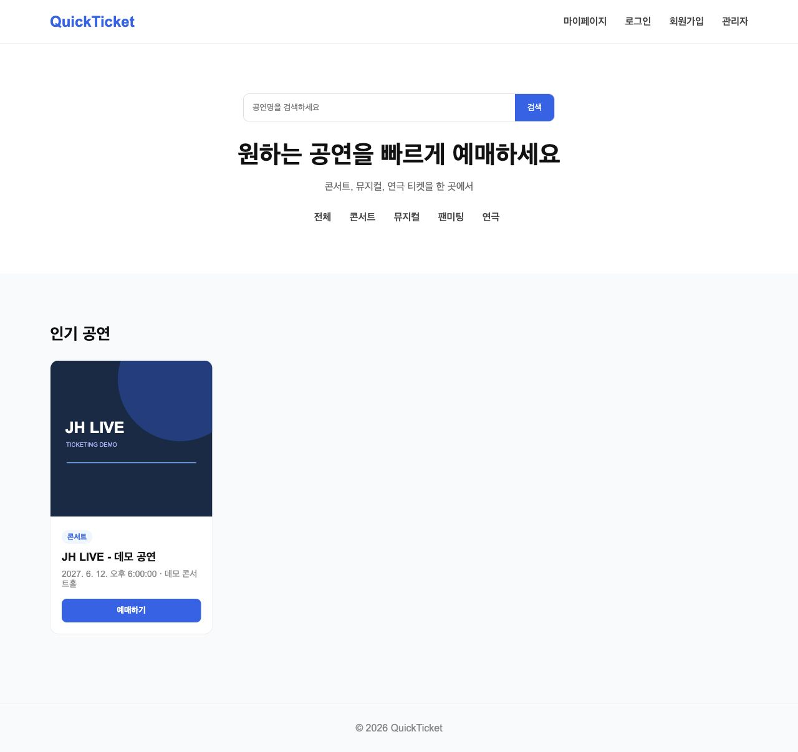
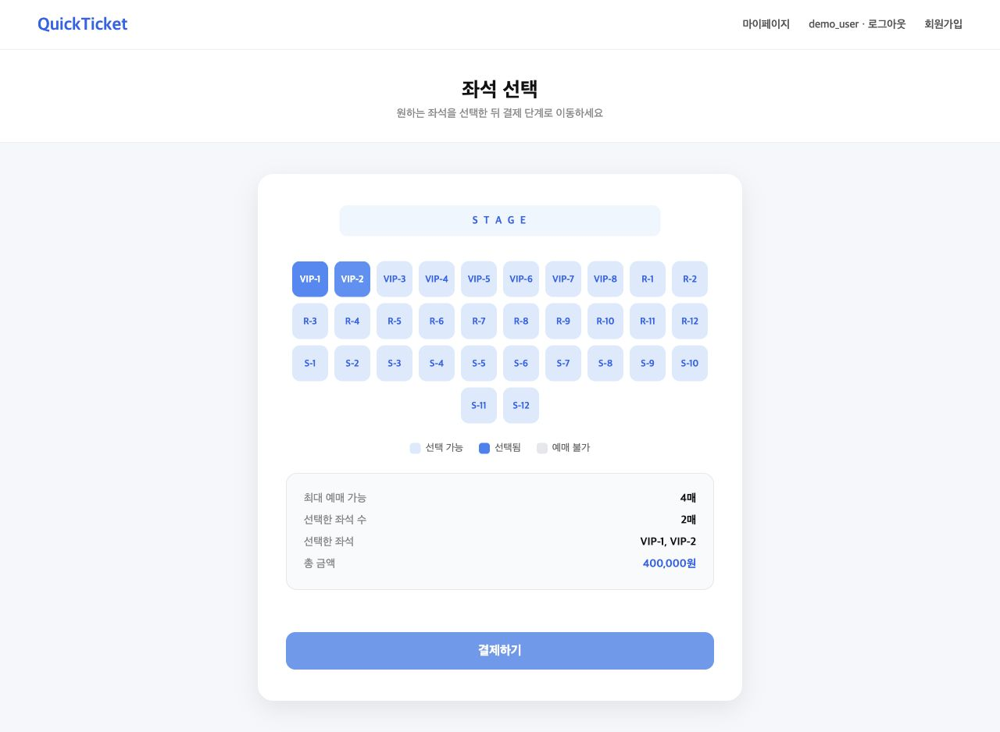
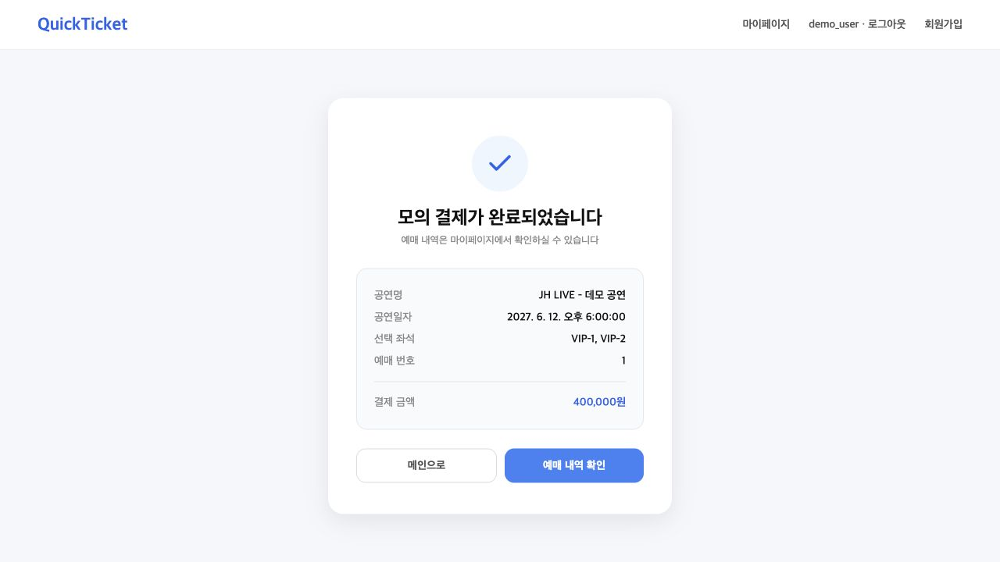
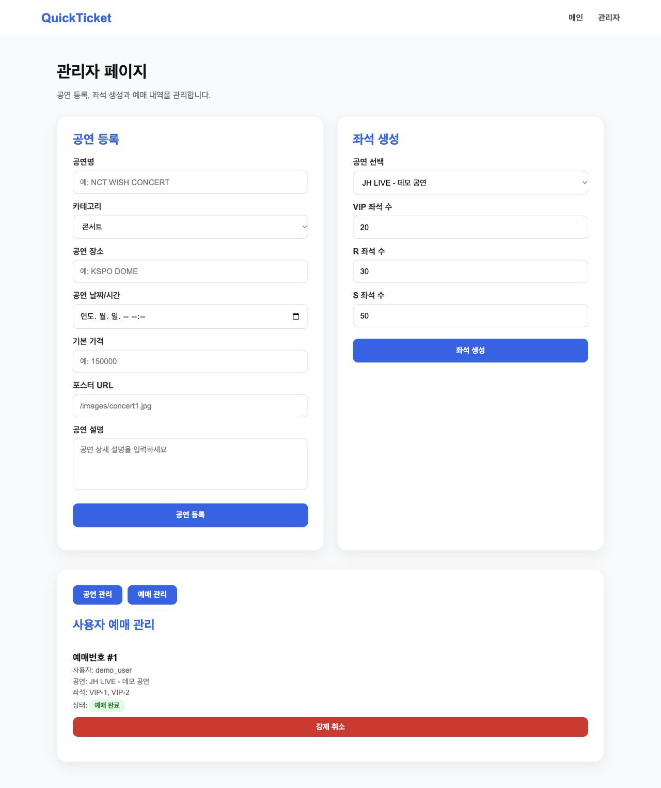

<div align="center">

# QuickTicket

**공연 조회부터 입장 대기·좌석 선점·예매·모의 결제까지 구현한 개인 프로젝트**

Java 17 · Spring Boot 3.5 · Spring Security · JPA · MySQL

[핵심 설계](docs/ARCHITECTURE.md) · [테스트와 검증 범위](docs/VALIDATION.md) · [기존 DB 적용 안내](docs/MIGRATION.md)

</div>

## 어떤 프로젝트인가요?

공연 티켓 예매의 주요 흐름을 직접 구현한 웹 애플리케이션입니다. 좌석을 선택하는 화면뿐 아니라 **누가 선점했는지, 동시에 요청하면 어떻게 되는지, 취소·시간 만료 후 좌석을 언제 돌려주는지**를 서버에서 관리합니다.

**개인 프로젝트**로 설계 문서 작성, Spring Boot API, 데이터 모델과 웹 화면을 구성했습니다. 초기 구현에서 부족했던 인증·소유권·상태 전이를 보완하고 핵심 요청에 대한 통합 테스트를 추가했습니다.

> 결제는 체험용 **모의 결제**입니다. 실제 PG나 금융기관에 연결하지 않으며, 카드 정보 수집·청구·송금·환불은 발생하지 않습니다.

## 주요 흐름


| 기능 | 동작 |
|---|---|
| 회원가입·로그인 | BCrypt 비밀번호 저장, 서버 세션 인증, 로그아웃 |
| 공연 조회 | 공연 목록·상세·좌석 정보 조회 |
| 입장 대기 | 사용자·공연별 대기표, 스케줄러 승인과 입장 유효기간 |
| 좌석 선점 | 입장한 사용자가 최대 4매 선점, 5분 만료, DB 잠금 |
| 예매 | 본인 선점·공연 일치·만료·중복 좌석 검증 후 원자적 예약 |
| 모의 결제 | 서버 좌석 가격으로 금액 검증, 예매당 결제 1개, 중복 확정 처리 |
| 취소·만료 | 예매·모의 결제 상태 변경과 좌석 반환 |
| 관리자 | 관리자 전용 공연 등록·좌석 생성·예매 조회·취소 |

## 실행 화면

로컬 데모 데이터로 직접 실행한 화면입니다.

| 공연 목록 | 좌석 선택 | 예매 완료 |
|---|---|---|
|  |  |  |

<details>
<summary>관리자 화면 보기</summary>



</details>

## 핵심 개선과 설계 판단

| 초기 구현의 문제 | 개선한 동작 |
|---|---|
| 로그인 성공 문구만 반환하고 브라우저에 사용자 번호 1 저장 | 실제 사용자 정보와 서버 세션을 연결 |
| 관리자 API를 포함한 모든 요청 허용 | 회원·관리자 접근을 분리하고 상태 변경 요청에 CSRF 검증 |
| 좌석에 선점자 정보가 없음 | 선점자 ID·만료 시각을 저장하고 타인 좌석 예매 차단 |
| 대기번호가 0이면 입장 가능하다고 화면에서 판단 | 서버의 ALLOWED 상태와 유효기간으로 입장 검증 |
| 클라이언트의 결제 금액을 그대로 저장 | DB 좌석 가격 합계를 기준으로 검증 |
| 취소·결제 중단 후 좌석 상태가 남을 수 있음 | 취소와 미결제 만료에 좌석 반환을 연결 |

### 동시 요청과 좌석 이력

좌석 선점은 DB의 비관적 쓰기 잠금으로 직렬화합니다. 여러 좌석을 예매할 때는 **좌석 ID 오름차순으로 잠그고 전체 조건을 확인한 뒤 함께 변경**합니다. 일부 좌석의 검증이 실패하면 예매가 생성되지 않습니다.

취소된 예매도 좌석 이력을 보존할 수 있도록 예매–좌석 관계를 구성했습니다. 현재 점유 상태는 좌석 테이블에서 관리하고, 이미 취소된 과거 예매를 다시 취소해도 새 예매의 좌석이 풀리지 않도록 처리했습니다.

### 인증과 사용자 정보

요청 본문의 `userId`나 localStorage를 인증 기준으로 사용하지 않습니다. 로그인된 서버 세션의 사용자로 소유권을 확인하며, 비밀번호와 IP는 예매 JSON 응답에서 제외합니다.

## 로컬에서 실행하기

**필수: JDK 17.** Gradle Wrapper를 사용하므로 Gradle을 따로 설치하지 않아도 됩니다.

### 바로 확인하는 데모

```bash
./gradlew bootRun --args='--spring.profiles.active=demo'
```

Windows PowerShell:

```powershell
.\gradlew.bat bootRun --args="--spring.profiles.active=demo"
```

브라우저에서 [http://localhost:8080/mainpage.html](http://localhost:8080/mainpage.html)을 엽니다. 별도 DB 설치 없이 가상 공연과 좌석을 확인할 수 있습니다.

| 용도 | 아이디 | 비밀번호 |
|---|---|---|
| 일반 회원 체험 | `demo_user` | `demo-user-change-me` |
| 관리자 체험 | `demo_admin` | `demo-admin-change-me` |

이 계정은 **demo 프로필의 메모리 DB에만 생성되는 가상 계정**입니다. 재시작하면 데모 데이터가 초기화되며 운영 배포에 사용하지 않습니다.

체험 순서: 회원 로그인 → 공연 예매 → 대기열 입장 → 좌석 선택 → 모의 결제 → 내 예매 조회·취소.
관리자는 `/admin.html`에서 공연·좌석·예매를 관리합니다.

### MySQL 환경

기본 프로필은 기존 `application.properties`의 환경변수로 MySQL에 연결합니다. 실제 배포 전에 [스키마 변경과 적용 순서](docs/MIGRATION.md)를 확인해야 합니다. 이전 배포 링크를 새 코드의 검증 완료 서비스로 제시하지 않습니다.

## 테스트

```bash
./gradlew test
./gradlew bootJar
```

**통합 테스트 26개**는 인증·소유권·입장 허가·선점 만료·동시 요청·금액 검증·취소 시 상태 복구를 확인합니다.
결과 HTML은 `build/reports/tests/test/index.html`에서 확인합니다. GitHub Actions에도 같은 빌드·테스트 명령을 구성했습니다.

검증은 **H2 환경의 통합 테스트**를 기준으로 합니다. MySQL 운영 환경의 동시성·부하 성능이나 분산 대기열을 입증한 결과는 아닙니다. [검증 범위](docs/VALIDATION.md)

## 구조

```text
src/main/java/com/example/ticketing/
├── config/       # 인증·세션·로컬 데모 초기화
├── controller/   # 회원·공연·대기열·좌석·예매·모의 결제 API
├── service/      # 소유권 검증·트랜잭션·상태 전이
├── repository/   # JPA 조회와 잠금
├── entity/       # 사용자·공연·좌석·예매·결제·대기표
└── scheduler/    # 입장 허가와 선점·미결제 만료
src/main/resources/static/   # 웹 화면·공통 세션/CSRF 요청 처리
src/test/                   # MockMvc + H2 통합 테스트
.github/workflows/ci.yml     # JDK 17 빌드·테스트
```

원래 작성한 요구사항·분석·설계 문서와 UML `.mdj` 파일은 저장소에 보존했습니다. 현재 동작의 설명은 README와 `docs/`를 기준으로 합니다.

## 남은 과제

- 기존 MySQL 데이터 마이그레이션 및 운영 환경에서의 잠금 검증
- 분산 환경에서 사용할 대기열·입장량 제어와 부하 테스트
- 실제 PG 도입 시 서버 간 승인·Webhook 검증·멱등키 설계
- 운영용 관리자 계정 관리, 관측 지표와 알림

현재 대기열은 단일 애플리케이션에서 5초마다 한 명을 허용하는 데모 구현입니다. 고객센터 문의처럼 서버 구현이 없는 화면은 제공 기능에서 제외했습니다.
