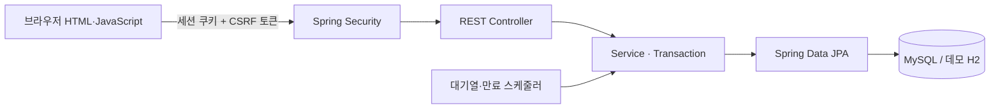
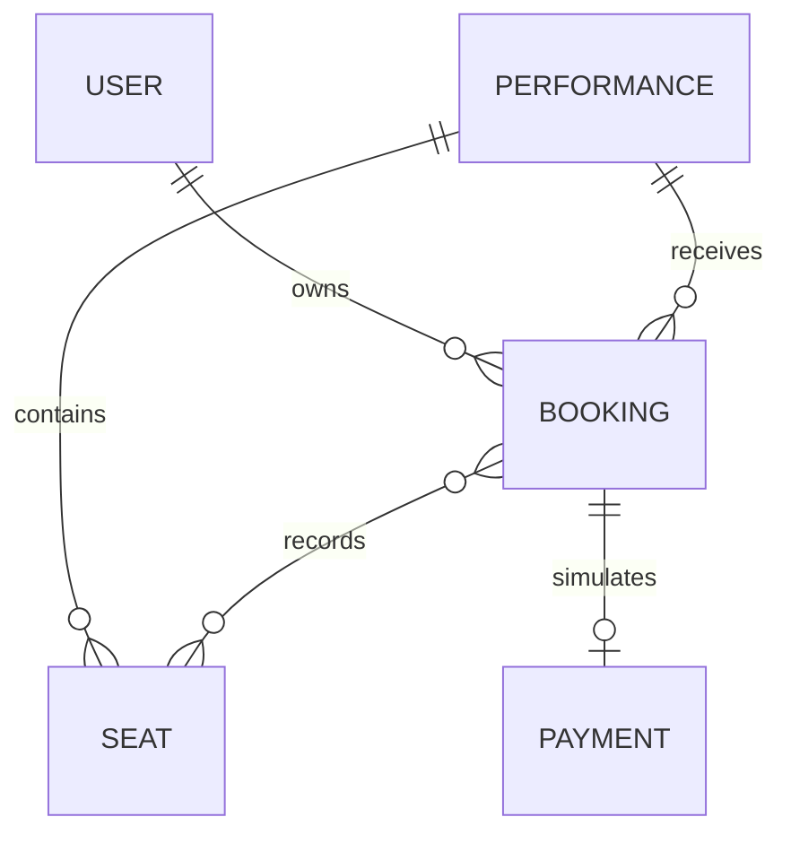
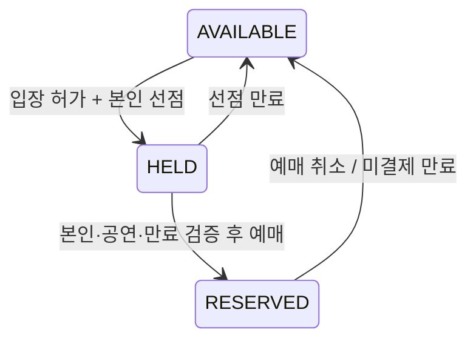

# 구조와 상태 전이

## 요청 처리

인증 기준은 서버 세션입니다. localStorage의 사용자 번호나 요청 본문의 userId는 접근 권한의 근거로 쓰지 않습니다.
화면 입력·조회는 Controller, 소유권과 상태 변경은 Service, 잠금은 Repository 경계에서 관리합니다.

## 핵심 관계

취소된 예매도 좌석 이력을 유지합니다. 같은 좌석이 과거·현재 예매에 기록될 수 있지만,
현재 예약 여부는 SEAT 상태와 잠금으로 판단합니다. 결제는 예매당 하나입니다.

## 상태 전이

- HELD: 선점자 ID와 5분 만료 시각을 저장합니다. 같은 사용자의 재요청은 만료 시간을 연장하지 않습니다.
- 예매 생성 시 좌석을 ID 순서로 잠그고 모든 좌석을 검증한 뒤 한 트랜잭션에서 변경합니다.
- PENDING 예매에는 별도 5분 결제 유효기간이 있습니다. 시간이 지난 예매는 모의 결제 확정이 거절되며 스케줄러가 좌석을 반환합니다.
- 취소 재요청은 이후 다른 사용자가 예매한 좌석을 다시 해제하지 않습니다.

## 대기열

사용자·공연별 활성 대기표를 재사용합니다. DB 자동 증가 ID로 요청 순서를 정하고 WAITING 상태를 스케줄러가 ALLOWED로 변경합니다.
현재 구현은 전체 공연을 통틀어 5초마다 한 명을 허용하는 단일 애플리케이션 데모입니다.
ALLOWED의 5분 유효기간을 서버에서 검증하며 대기번호가 0이라는 이유로 입장을 허용하지 않습니다.
분산 대기열·실서비스 처리량 제어를 구현했다고 주장하지 않습니다.
